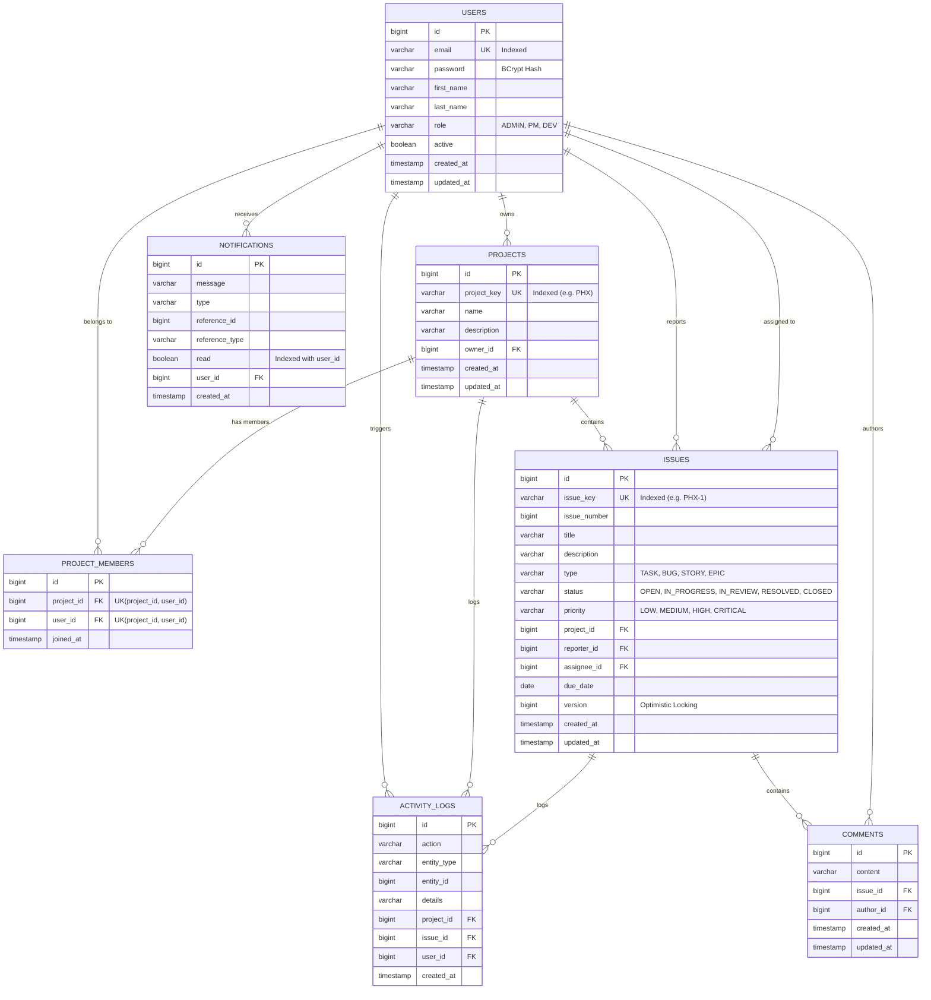

# Jira-Lite — System Architecture & Design Specification

## 1. Architectural Overview

Jira-Lite is structured as a **modern layered monolith** paired with a decoupled **Single Page Application (SPA)** frontend. The design prioritizes high coherence, strict layer decoupling, ACID transaction guarantees, distributed caching, and role-based access control (RBAC).

```
                      ┌───────────────────────────────────────────────┐
                      │              React 19 SPA (Vite)              │
                      │  Kanban Board, Dashboards, Sprints, Comments  │
                      └───────────────────────┬───────────────────────┘
                                              │ HTTP / JSON
                                              │ Authorization: Bearer <JWT>
                                              ▼
                      ┌───────────────────────────────────────────────┐
                      │           Spring Boot 4.1.1 API               │
                      │ ┌───────────────────────────────────────────┐ │
                      │ │       Spring Security & JWT Filter        │ │
                      │ └─────────────────────┬─────────────────────┘ │
                      │                       ▼                       │
                      │ ┌───────────────────────────────────────────┐ │
                      │ │         REST Controllers Layer            │ │
                      │ └─────────────────────┬─────────────────────┘ │
                      │                       ▼                       │
                      │ ┌───────────────────────────────────────────┐ │
                      │ │      Service Layer (Business Logic)       │ │
                      │ └──────────────┬────────────────────────────┘ │
                      │                │         │                    │
                      │   @Cacheable   │         │                    │
                      │                ▼         ▼                    │
                      │        ┌─────────┐   ┌──────────────────────┐ │
                      │        │  Redis  │   │ JPA Repositories     │ │
                      │        │ Cache 7 │   │ Hibernate 6 / ORM    │ │
                      │        └─────────┘   └──────────┬───────────┘ │
                      └─────────────────────────────────┼─────────────┘
                                                        ▼
                                             ┌──────────────────────┐
                                             │    PostgreSQL 16     │
                                             │ Relational DB Engine │
                                             └──────────────────────┘
```

---

## 2. Layered Responsibilities

| Layer | Responsibility | Key Classes |
|---|---|---|
| **Presentation (Frontend)** | Responsive UI, state management, drag-and-drop Kanban, debounced search, real-time unread badges | `App.tsx`, `Kanban`, `ProjectDetail.tsx`, `Dashboard.tsx` |
| **Security Layer** | Stateless JWT parsing, BCrypt password hashing, method-level authorization (`@PreAuthorize`) | `JwtAuthenticationFilter`, `SecurityConfig`, `CustomUserDetailsService` |
| **API / Controller** | Route mapping, HTTP status codes, request validation (`@Valid`), OpenAPI documentation | `AuthController`, `ProjectController`, `IssueController`, etc. |
| **Service Layer** | Transaction management (`@Transactional`), business rules, activity audit logging, notifications, Redis cache eviction | `IssueService`, `ProjectService`, `AuthService`, `DashboardService` |
| **Data Access / Repository** | Spring Data JPA, HQL/JPQL queries, derived methods, composite count optimizations | `IssueRepository`, `ProjectRepository`, `UserRepository` |
| **Domain Model** | JPA Entities, composite unique constraints, database indexing, foreign keys, optimistic locking (`@Version`) | `Issue`, `Project`, `ProjectMember`, `User`, `Comment`, `ActivityLog` |

---

## 3. Relational Database Schema Design



---

## 4. Key Engineering Implementations

### A. Optimistic Locking for Concurrent Updates
To prevent lost updates in multi-user collaboration, the `Issue` entity implements JPA optimistic locking:
```java
@Version
@Column(name = "version")
private Long version;
```
When two users update an issue simultaneously, Hibernate checks the version column upon commit. The second commit fails with `ObjectOptimisticLockingFailureException`, which is caught by `GlobalExceptionHandler` and returns HTTP `409 Conflict`, prompting the client to reload the latest state.

### B. Redis Distributed Caching & Eviction
Frequent read queries are cached in Redis with configurable TTLs:
* `projects`: TTL 15 minutes
* `issues`: TTL 5 minutes
* `dashboard`: TTL 2 minutes
Cache eviction (`@CacheEvict`) is automatically triggered upon any issue creation, assignment, status transition, or deletion to guarantee data freshness.

### C. Role-Based Access Control (RBAC) Matrix

| Operation | Admin | Project Manager | Developer |
|---|:---:|:---:|:---:|
| Create Project | ✅ | ✅ | ❌ |
| Delete Project | ✅ | Only if Owner | ❌ |
| Add/Remove Project Members | ✅ | ✅ (If Member) | ❌ |
| Create & Assign Issue | ✅ | ✅ | ✅ (If Member) |
| Move Issue on Kanban Board | ✅ | ✅ | ✅ (If Member) |
| Edit/Delete Own Comments | ✅ | ✅ | ✅ |
| Delete Other User's Comment | ✅ | ❌ | ❌ |
| Deactivate User Account | ✅ | ❌ | ❌ |

---

## 5. Security & Authentication Flow

1. **Authentication**: Users submit email & password to `POST /api/auth/login`.
2. **Verification**: Spring Security's `AuthenticationManager` verifies credentials against `BCryptPasswordEncoder`.
3. **Token Issuance**: `JwtTokenProvider` signs an HMAC-SHA256 JWT containing user subject and validity period (24 hours default).
4. **Per-Request Authorization**: `JwtAuthenticationFilter` intercepts requests, extracts the `Bearer` token from `Authorization` header, validates signature and expiration, loads `UserDetails`, and populates `SecurityContextHolder`.

