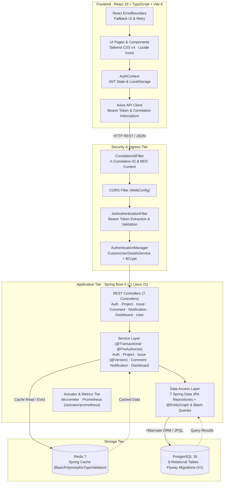
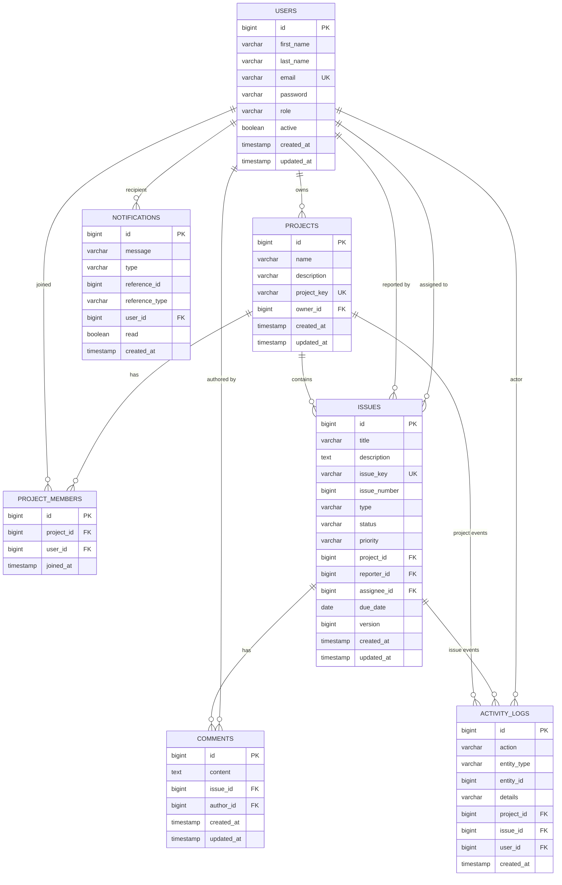

<div align="center">


# Jira-Lite

**A Production-Quality, Full-Stack Project Management and Issue Tracking Platform**

[](https://openjdk.org/projects/jdk/21/)
[](https://spring.io/projects/spring-boot)
[](https://react.dev/)
[](https://www.typescriptlang.org/)
[](https://tailwindcss.com/)
[](https://www.postgresql.org/)
[](https://redis.io/)
[](https://docs.docker.com/compose/)
[](.github/workflows/ci.yml)
[](https://junit.org/junit5/)
[](https://vitest.dev/)
[](https://prometheus.io/)
[](LICENSE)

[Features](#-key-features) • [Screenshots](#-application-screenshots) • [Architecture](#-system-architecture) • [Database Schema](#-database-er-diagram) • [Auth & RBAC](#-authentication--role-based-authorization) • [API Spec](#-api-documentation) • [Setup](#-installation--setup) • [Testing](#-testing)

</div>

---

## 📌 Overview

**Jira-Lite** is a modern, responsive issue tracking and agile project management system inspired by Atlassian Jira. Designed and engineered as a showcase software engineering portfolio application, it demonstrates production-grade full-stack patterns:

- **Type-Safe Enterprise Architecture**: Java 21 and Spring Boot 4.1.1 backend paired with a React 19 + TypeScript + Vite 8 frontend.
- **Strict Data Isolation & Multi-Project RBAC**: Method-level security guards (`@PreAuthorize`) and domain ownership checks enforcing permissions across `ADMIN`, `PROJECT_MANAGER`, and `DEVELOPER`.
- **Concurrent Update Safety**: JPA optimistic locking (`@Version`) preventing lost updates when multiple team members edit issues concurrently (HTTP 409 Conflict).
- **High-Throughput Caching**: Redis 7 cache abstraction (`@Cacheable` / `@CacheEvict`) for project boards and dashboard analytics with hardened type deserialization (`BasicPolymorphicTypeValidator`).
- **Database Query Optimization**: Eager association fetching via `@EntityGraph` eliminating N+1 queries during issue retrieval, alongside batch aggregate queries (`GROUP BY`) for project counts.
- **Enterprise Observability**: Distributed tracing with `X-Correlation-ID` header validation, SLF4J MDC cleanup, structured error responses, and secure Micrometer Prometheus metrics (`/actuator/prometheus`).
- **Frontend Reliability**: React Error Boundary fallback, React Router-compatible 401 session clearing, and optimistic Kanban drag-and-drop with automatic rollback on API failure.

---

## 📸 Application Screenshots

<table>
  <tr>
    <td width="50%" align="center">
      
      <br/>
      <b>Authentication &amp; Role Quick-Login</b>
      <p><sub>JWT authentication with credential fast-fill buttons for Admin, PM, and Developer roles.</sub></p>
    </td>
    <td width="50%" align="center">
      
      <br/>
      <b>Executive Metrics Dashboard</b>
      <p><sub>Real-time project statistics, task completion rates, issue status distribution, and recent activity.</sub></p>
    </td>
  </tr>
  <tr>
    <td width="50%" align="center">
      
      <br/>
      <b>Project Directory &amp; Management</b>
      <p><sub>Workspace projects overview with unique project keys, member counts, and ownership metadata.</sub></p>
    </td>
    <td width="50%" align="center">
      
      <br/>
      <b>Interactive Kanban Board</b>
      <p><sub>Visual drag-and-drop across Open, In Progress, In Review, Resolved, and Closed stages.</sub></p>
    </td>
  </tr>
  <tr>
    <td width="50%" align="center">
      
      <br/>
      <b>Issue Lifecycle, Comments &amp; Audit Trail</b>
      <p><sub>Full issue view with optimistic lock versioning, threaded discussion, and historical audit log.</sub></p>
    </td>
    <td width="50%" align="center">
      
      <br/>
      <b>Workspace Team Directory</b>
      <p><sub>Member listing with role badges, email accounts, and project membership tracking.</sub></p>
    </td>
  </tr>
  <tr>
    <td colspan="2" align="center">
      
      <br/>
      <b>In-App Notification Center</b>
      <p><sub>Real-time unread counter, event-driven notification feed, and bulk read actions.</sub></p>
    </td>
  </tr>
</table>

---

## ⚡ Key Features

| Capability | Technical Implementation |
|---|---|
| **Stateless JWT Security** | JJWT (`0.12.6`) token provider with HMAC-SHA256 signature verification and BCrypt password encryption. |
| **Role-Based Access Control** | `@EnableMethodSecurity` with declarative `@PreAuthorize` rules on controllers and services. |
| **Interactive Kanban Board** | 5-stage lifecycle (`OPEN`, `IN_PROGRESS`, `IN_REVIEW`, `RESOLVED`, `CLOSED`) with drag-and-drop state transitions. |
| **Optimistic Concurrency Control** | JPA `@Version` column on `Issue` preventing race conditions during simultaneous edits (HTTP 409 Conflict handling). |
| **Distributed Caching** | Redis 7 caching for projects, issues, and dashboard metrics with `@CacheEvict` cache invalidation on writes. |
| **Threaded Discussion** | Issue comments with author-level modification and deletion constraints. |
| **Immutable Audit Logging** | Dedicated `activity_logs` table tracking who created, changed status, commented, or assigned each task. |
| **Notification Center** | Event-driven in-app notifications for task assignments and status updates with unread count badges. |
| **Full-Text Filter & Search** | Debounced cross-project search by keyword, status, priority, and issue type with JPA query optimization. |
| **Pagination & Sorting** | Server-side Spring Data `Pageable` pagination across all collection endpoints. |
| **Interactive OpenAPI Docs** | Swagger UI accessible at `/swagger-ui.html` for exploratory testing. |
| **Enterprise Observability** | Correlation ID filter (`X-Correlation-ID`), SLF4J MDC trace propagation, structured error payload, and Micrometer Prometheus metrics. |
| **Multi-Stage Containerization** | Modular `Dockerfile` and `docker-compose.yml` for backend, frontend, PostgreSQL, and Redis. |

---

## 🏗️ System Architecture

The following diagram illustrates the complete end-to-end request lifecycle and component relationships:



### Request Lifecycle
1. **Client Dispatch**: The React application sends asynchronous HTTP requests via Axios with `Authorization: Bearer <JWT>` and automatic `X-Correlation-ID` forwarding.
2. **Correlation ID & MDC**: `CorrelationIdFilter` inspects or generates a UUID correlation ID, validates against injection attacks, populates SLF4J MDC, and ensures cleanup in a `finally` block.
3. **Security Gateway**: `JwtAuthenticationFilter` intercepts the request, verifies signature and expiration via `JwtTokenProvider`, validates that the user account is active (`isEnabled()`), and sets the Spring `SecurityContext`.
4. **Controller Guard**: Incoming requests are validated (`@Valid`) and checked against role permissions via `@PreAuthorize`.
5. **Cache Interception & Isolation**: Services evaluate `@Cacheable` methods against Redis before querying the database, while enforcing domain membership authorization on every request.
6. **JPA Persistence & Query Optimization**: Data operations execute within `@Transactional` boundaries using `@EntityGraph` to eliminate N+1 queries. Updates check `@Version` to guarantee optimistic locking integrity.
7. **Cache Eviction & Audit**: Write operations trigger `@CacheEvict` to flush stale caches, log events to `ActivityLog`, and generate `Notification` records.

---

## 🗄️ Database ER Diagram

The database schema is managed via Flyway migrations (`V1__init_schema.sql`) and backed by PostgreSQL 16 (or in-memory H2 during testing):



---

## 🔐 Authentication & Role-Based Authorization

### Role Hierarchy & Permissions

| Role | Scope & Permissions |
|---|---|
| `ADMIN` | Global platform administration. Can deactivate users, inspect all workspace projects, manage global configuration, delete any issue or comment, and access Prometheus metrics (`/actuator/prometheus`). |
| `PROJECT_MANAGER` | Can create new projects, add or remove project members, assign issues, edit project metadata, and manage sprint issues. |
| `DEVELOPER` | Can view accessible projects, create issues, transition issue statuses (`OPEN` ➔ `CLOSED`), comment on issues, and manage their assigned tasks. |

### How Demo Accounts & Quick-Login Buttons Work
- **Automatic Seed on First Boot**: When the application starts, `DataInitializer.java` checks whether `userRepository.count() == 0`. If the database is empty, it automatically seeds three workspace accounts (Admin, Project Manager, Developer) using passwords configured via environment variables.
- **Quick Demo Login Buttons**: On the `/login` screen, the **Admin**, **PM**, and **Dev** buttons are **client-side credential autofill helpers only**. They populate the email and password inputs with the standard test credentials. They do **not** bypass authentication: the user must submit the form, triggering a genuine `POST /api/auth/login` request, BCrypt password check, and JWT token issuance.
- **Disabling Account Seeding**: To run without seeding default accounts (e.g., in a production environment), set `app.seed.enabled=false`.

### User Registration Behaviour
- When registering via `POST /api/auth/register`, the backend service (`AuthService.java`) **strictly assigns `Role.DEVELOPER` by default**.
- Users **cannot** register themselves as `ADMIN` or `PROJECT_MANAGER`. Role escalation must be performed by an existing administrator.
- Deactivated users (`active = false`) are automatically excluded from all user listings (`findByActiveTrue`) and cannot authenticate or use existing tokens (`isEnabled()` check in `JwtAuthenticationFilter`).

---

## 📁 Project Structure

```
jira-lite/
├── frontend/                         # React 19 + TypeScript Frontend
│   ├── src/
│   │   ├── pages/                    # Application Views
│   │   │   ├── Login.tsx             # Auth form & demo autofill
│   │   │   ├── Register.tsx          # New user registration
│   │   │   ├── Dashboard.tsx         # Metrics, progress & activity stream
│   │   │   ├── Projects.tsx          # Projects catalog & create modal
│   │   │   ├── ProjectDetail.tsx     # Kanban board & list view
│   │   │   ├── IssueDetail.tsx       # Issue view, comments & audit log
│   │   │   ├── MyIssues.tsx          # Personal task list
│   │   │   ├── TeamMembers.tsx       # Workspace user directory
│   │   │   └── Settings.tsx          # User profile
│   │   ├── components/               # Reusable UI widgets (Navbar, Sidebar, Modal, Toast, ErrorBoundary)
│   │   ├── context/AuthContext.tsx   # React Auth Context & session management
│   │   ├── services/api.ts           # Axios client with correlation & 401 interceptors
│   │   └── types/index.ts            # TypeScript interfaces & enums
│   ├── Dockerfile                    # Multi-stage production build (Vite -> Nginx)
│   ├── nginx.conf                    # Nginx reverse proxy & SPA routing
│   └── vitest.config.ts              # Vitest & jsdom test configuration
│
├── jira-lite/                        # Spring Boot 4.1.1 Backend
│   ├── src/main/java/com/jiralite/
│   │   ├── config/                   # SecurityConfig, RedisConfig, WebConfig, OpenApiConfig, FlywayConfig
│   │   ├── controller/               # REST API Controllers (7 controllers)
│   │   ├── dto/                      # Request & Response Records
│   │   ├── entity/                   # JPA Entities (8 entities)
│   │   ├── exception/                # GlobalExceptionHandler & structured ErrorResponse
│   │   ├── model/                    # Enums (Role, IssueStatus, IssueType, Priority)
│   │   ├── repository/               # Spring Data JPA Repositories (7 interfaces)
│   │   ├── security/                 # JwtTokenProvider, JwtAuthenticationFilter, CorrelationIdFilter
│   │   └── service/                  # Business logic & caching layer (8 services)
│   ├── src/main/resources/
│   │   ├── db/migration/             # Flyway database migration scripts (V1__init_schema.sql)
│   │   └── application.yml           # Externalized configuration
│   ├── Dockerfile                    # Multi-stage build (Maven -> Eclipse Temurin 21 JRE)
│   └── pom.xml                       # Maven dependency management
│
├── docs/screenshots/                 # Genuine application screenshots
├── docker-compose.yml                # Multi-container orchestration
├── .env.example                      # Template for environment variables
└── README.md                         # Project documentation
```

---

## 📡 API Documentation

Interactive Swagger documentation is available at **`/swagger-ui.html`** when the backend is running.

### Key Endpoints

| Category | Method | Endpoint | Description | Role Required |
|---|---|---|---|---|
| **Auth** | `POST` | `/api/auth/register` | Register new account (assigns `DEVELOPER`) | Public |
| **Auth** | `POST` | `/api/auth/login` | Authenticate and obtain JWT bearer token | Public |
| **Users** | `GET` | `/api/users/me` | Fetch authenticated user profile | Authenticated |
| **Users** | `GET` | `/api/users` | List active workspace users (paginated) | Authenticated |
| **Users** | `DELETE`| `/api/users/{id}` | Deactivate user account | `ADMIN` |
| **Projects** | `GET` | `/api/projects` | List projects accessible to user (paginated) | Authenticated |
| **Projects** | `POST`| `/api/projects` | Create a new project | `ADMIN`, `PROJECT_MANAGER` |
| **Projects** | `GET` | `/api/projects/{id}` | Get project metadata and members | Authenticated |
| **Projects** | `POST`| `/api/projects/{id}/members` | Add user to project team | Project Owner / PM |
| **Projects** | `DELETE`| `/api/projects/{id}/members/{userId}` | Remove user from project | Project Owner / PM |
| **Projects** | `GET` | `/api/projects/{id}/activity` | Retrieve project audit logs | Authenticated |
| **Issues** | `POST`| `/api/issues/project/{id}` | Create issue in project | Project Member |
| **Issues** | `GET` | `/api/issues/project/{id}` | Query issues in project (filterable) | Authenticated |
| **Issues** | `GET` | `/api/issues/{id}` | Retrieve full issue details | Authenticated |
| **Issues** | `PUT` | `/api/issues/{id}` | Update issue title, desc, due date | Project Member |
| **Issues** | `PATCH`| `/api/issues/{id}/status` | Transition issue status (`OPEN` ➔ `CLOSED`) | Project Member |
| **Issues** | `PATCH`| `/api/issues/{id}/assign` | Assign issue to team member | Project Member |
| **Issues** | `GET` | `/api/issues/my` | Get current user's assigned issues | Authenticated |
| **Issues** | `GET` | `/api/issues/search?query=` | Full-text search across accessible issues | Authenticated |
| **Comments**| `POST`| `/api/issues/{id}/comments` | Post comment on issue | Project Member |
| **Comments**| `DELETE`| `/api/issues/{id}/comments/{cid}` | Remove comment | Author or `ADMIN` |
| **Notifs** | `GET` | `/api/notifications` | Get user notifications (paginated) | Authenticated |
| **Notifs** | `GET` | `/api/notifications/unread-count` | Get count of unread notifications | Authenticated |
| **Notifs** | `PATCH`| `/api/notifications/read-all` | Mark all notifications as read | Authenticated |
| **Dashboard**| `GET`| `/api/dashboard` | Aggregated system metrics | Authenticated |
| **Actuator**| `GET`| `/actuator/health` | Application and probe health status | Public |
| **Metrics** | `GET`| `/actuator/prometheus` | Prometheus formatted application metrics | `ADMIN` |

---

## 🚀 Installation & Setup

### Prerequisites
- **Java 21 JDK** (e.g. Eclipse Temurin 21 or Microsoft OpenJDK 21)
- **Node.js 20+** and **npm**
- **PostgreSQL 16** and **Redis 7** (native services or via Docker)

---

### Method 1: Local Development (Native)

#### 1. Configure Infrastructure
Ensure PostgreSQL is listening on port `5432` and Redis on `6379`:
```sql
CREATE DATABASE jiralite;
CREATE USER jiralite WITH PASSWORD '<your-secure-db-password>';
GRANT ALL PRIVILEGES ON DATABASE jiralite TO jiralite;
```

#### 2. Start Spring Boot Backend
```bash
cd jira-lite

# Set environment variables (Linux/macOS)
# Generate a JWT secret: openssl rand -base64 64
export DB_USERNAME=jiralite
export DB_PASSWORD=<your-secure-db-password>
export JWT_SECRET=<base64-encoded-secret-min-256-bits>
export SEED_ADMIN_PASSWORD=<strong-admin-password>
export SEED_PM_PASSWORD=<strong-pm-password>
export SEED_DEV_PASSWORD=<strong-dev-password>

# Run backend (Flyway runs migrations, then seeds default users if DB is empty)
./mvnw spring-boot:run
```
*(On Windows PowerShell, use `$env:DB_USERNAME="jiralite"`, etc., then `.\mvnw.cmd spring-boot:run`)*

The backend initializes on **`http://localhost:8080`**.

#### 3. Start React Frontend
```bash
cd frontend
npm install
npm run dev
```

The frontend dev server launches on **`http://localhost:5173`**.

---

### Method 2: Docker Compose Deployment

The repository includes a complete multi-container setup orchestrating the frontend, backend, PostgreSQL 16, and Redis 7.

```bash
# 1. Clone the repository and configure environment variables
cp .env.example .env
# Edit .env to set your passwords and secrets

# 2. Build and launch all services
docker compose --env-file .env up --build
```

- **Frontend**: `http://localhost:3000` (served by Nginx with API reverse proxy)
- **Backend API**: `http://localhost:8080`
- **Swagger UI**: `http://localhost:8080/swagger-ui.html`

> **Note on Environment Ports**: If PostgreSQL (`5432`) or Redis (`6379`) are already running natively on your host machine, modify `POSTGRES_PORT` and `REDIS_PORT` in your `.env` file (e.g., `5433` and `6380`) to prevent port conflicts.

---

## 🔧 Environment Variables

All sensitive values are strictly externalized. Never commit the `.env` file to version control.

| Variable | Description | Default / Example | Required |
|---|---|---|---|
| `DB_USERNAME` | PostgreSQL database user | `jiralite` | Yes |
| `DB_PASSWORD` | PostgreSQL database password | *Custom secure password* | Yes |
| `POSTGRES_DB` | PostgreSQL database name | `jiralite` | Yes |
| `JWT_SECRET` | Base64-encoded HMAC-SHA256 secret (>= 256 bits) | *Generate via openssl* | Yes |
| `SEED_ADMIN_PASSWORD` | Initial password for seeded Admin account | *Custom strong password* | Yes |
| `SEED_PM_PASSWORD` | Initial password for seeded PM account | *Custom strong password* | Yes |
| `SEED_DEV_PASSWORD` | Initial password for seeded Dev account | *Custom strong password* | Yes |
| `app.seed.enabled` | Whether to seed default accounts if DB is empty | `true` | No |
| `POSTGRES_PORT` | Host exposed port for PostgreSQL container | `5432` | Docker only |
| `REDIS_PORT` | Host exposed port for Redis container | `6379` | Docker only |
| `BACKEND_PORT` | Host exposed port for Spring Boot container | `8080` | Docker only |
| `FRONTEND_PORT` | Host exposed port for React/Nginx container | `3000` | Docker only |

---

## 🧪 Testing

### Backend Test Suite (Maven & JUnit 5)
```bash
cd jira-lite
./mvnw test          # Linux/macOS
.\mvnw.cmd test      # Windows
```

#### Test Execution Summary (76 Tests)
- **Controller Slice (`@WebMvcTest` MockMvc)**:
  - `AuthControllerTest` (2 tests): Registration validation and login response.
  - `IssueControllerTest` (9 tests): Status codes, authorization, lifecycle transitions, field validation.
  - `ProjectControllerTest` (12 tests): Project CRUD, key format regex, member management, ownership validation.
  - `UserControllerTest` (6 tests): User lookup, active-user filtering, self-deactivation protection.
- **Service & Domain Slice**:
  - `AuthServiceTest` (4 tests): Registration, credential verification, JWT generation.
  - `IssueServiceTest` (4 tests): Issue keys, assignment logic, optimistic lock checks.
  - `ProjectServiceTest` (3 tests): Membership checks, project creation.
  - `UserServiceTest` (6 tests): User lookup, active user filtering, self-deactivation guards.
  - `SecurityAndAuthorizationTest` (13 tests): Cross-project isolation, PM mutation guards, comment authorization.
- **Performance & Observability Slice**:
  - `DatabasePerformanceTest` (3 tests): EntityGraph query count verification (≤4 queries for issues, 3 for projects with batch count aggregation).
  - `ObservabilityIntegrationTest` (11 tests): `X-Correlation-ID` header validation, SLF4J MDC trace propagation, structured error responses, and Prometheus metrics.
  - `JiraLiteApplicationTests` (1 test): Spring Boot application context load verification.

### Frontend Test Suite (Vitest & Testing Library)
```bash
cd frontend
npm test             # Run Vitest test suite
npm run build        # TypeScript check and Vite production bundle
```

#### Frontend Test Summary (17 Tests)
- `src/context/AuthContext.test.tsx` (5 tests): Session restoration, login/logout state, 401 unauthorized event dispatch.
- `src/components/ErrorBoundary.test.tsx` (4 tests): Error boundary catching, fallback UI rendering, reset/retry action.
- `src/pages/ProjectDetail.test.tsx` (4 tests): Optimistic Kanban drag-and-drop state update, automatic rollback on API rejection.
- `src/pages/Login.test.tsx` (4 tests): Form input validation, quick-fill demo buttons, API failure error toast.
